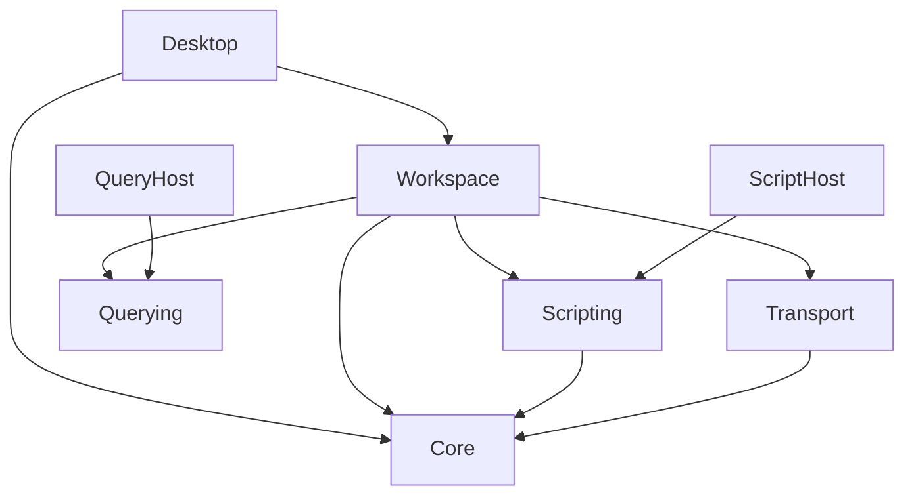

# Current architecture and process boundaries

The solution has **eight production projects and five test projects**. The original
specification's Generation/Synthea/CLI project proposals are not the current tree.
This page is the present-tense map; [legacy architecture](../architecture.md) and
[ADRs](../decisions/) retain design history. All examples/fixtures must be synthetic.

## Compile dependencies

Arrows below mean an ordinary assembly reference, not IPC or ownership:

| Project | Owns | Boundary and project reference |
| --- | --- | --- |
| Core | Lossless materialized parser/shared structural scanner, paths/escapes, serializer, controlled edits, comparison primitives, synthetic generation, FHIR projection/mapping, schema model/evaluator/import | No UI, Dock, files, network I/O or package dependencies. [Core project](../../src/HL7Workbench.Core/HL7Workbench.Core.csproj). |
| Workspace | File snapshots/indexing, document/active-message state, bounded edits/history, captures, publication, tool sessions, local definitions/preferences/layout DTOs | No Avalonia/Dock/SQLite engine types. References Core, Scripting, Querying and Transport. [Workspace project](../../src/HL7Workbench.Workspace/HL7Workbench.Workspace.csproj). |
| Desktop | Avalonia controls/editors, native pickers/dialogs, shell commands, feature view models and Dock adapters | Compiler-only Roslyn supports C# coloring/help; execution stays in ScriptHost. [Desktop project](../../src/HL7Workbench.Desktop/HL7Workbench.Desktop.csproj). |
| Scripting | Public script facade, globals/batch/report contracts, worker client/protocol and deterministic identity/de-identification helpers | Depends on Core, not Roslyn execution or UI. [Scripting project](../../src/HL7Workbench.Scripting/HL7Workbench.Scripting.csproj). |
| ScriptHost | Roslyn compilation, Main/Complete binding and trusted-code execution | Separate executable referencing Scripting; owns scripting runtime package. [ScriptHost project](../../src/HL7Workbench.ScriptHost/HL7Workbench.ScriptHost.csproj). |
| Querying | Typed closed schema, query/result/protocol contracts, worker client and lifetime policy | No Core/SQLite/UI dependency. [Querying project](../../src/HL7Workbench.Querying/HL7Workbench.Querying.csproj). |
| QueryHost | SQLite engine, native read-only authorization, bounded database and lazy field adapters | Separate executable referencing Querying; owns SQLitePCLRaw/native SQLite. No second HL7 parser. [QueryHost project](../../src/HL7Workbench.QueryHost/HL7Workbench.QueryHost.csproj). |
| Transport | Incremental MLLP byte framing, TCP/listener/exchange lifecycles | Depends on Core for header/ACK semantics; no UI or persistent payload store. [Transport project](../../src/HL7Workbench.Transport/HL7Workbench.Transport.csproj). |

Desktop and relevant tests additionally import [ScriptHost.targets](../../build/ScriptHost.targets)
and [QueryHost.targets](../../build/QueryHost.targets). These establish build-order
references with `ReferenceOutputAssembly=false`/`Private=false` and copy workers into
subdirectories. They do not load either host as a Desktop execution library. Keep
build/deployment edges distinct from the ordinary reference graph above.

## Runtime flow

Desktop coordinates Workspace on its owning context. Workspace freezes captures
before background work, uses Core's grammar for interpretation and publishes only
complete/current results. Long file scans and save proofs run off the UI thread.
Document state outlives replaceable Dock views. [Ownership](workspace-lifecycle.md)
and [coordinate origins](parser-invariants.md#coordinate-origins) are part of every
content feature's contract, not optional presentation details.

Script runs start a fresh ScriptHost process. SQL sessions start QueryHost with a
private in-memory SQLite database. Bounded, versioned private-pipe protocols provide
backpressure; cancellation/deadlines and Windows Job Objects contain resources and
reap workers. Separate processes do not create a general security sandbox. Scripts
are trusted account-privileged code; SQL has its own deny-by-default authorizer.
Transport work uses the separate Transport library within the application workflow,
not either worker, and requires explicit destination review.

Generated/extracted/script outputs are independent documents or atomic target
insertions. Source snapshots and captures have explicit owners; user save/export is
a separate persistence action. Layout DTOs store placement, never clinical content,
scripts, query results or network authorization. FHIR imports/profile evaluation
do not fetch remote references.

## Changes that need cross-boundary review

Reusing Core's scanner is required; a UI parser or SQL-specific HL7 grammar would
fork preservation/coordinate semantics. Adding Avalonia/Dock to Workspace or SQLite
to the parent defeats isolation. Changing worker protocols, stable tool IDs, persisted
formats or publication ordering needs compatibility/lifecycle tests and the affected
guides, not an ad hoc helper in a view.

The five test projects cover Core, Workspace, Desktop, Scripting and Querying;
Transport integration tests reside largely in Workspace.Tests. [Dependency/metadata
licensing](../dependencies.md) differs from release approval. No plugin discovery,
generic CLI or independently versioned plugin ABI is implemented; see
[supported seams](extension-points.md).
